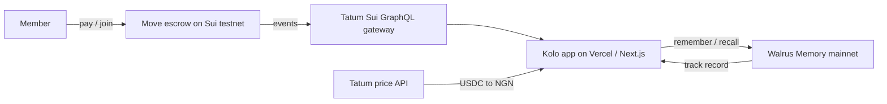

# Kolo

**A rotating savings circle (ajo / esusu) on Sui that pays out on its own and remembers who kept their word.**

Built for the Tatum x Walrus "Total Recall" hackathon (Consumer Finance Apps).

- **Live demo (no sign-in needed to view):** https://kolo-jade.vercel.app/circles/demo
- **Demo video:** https://drive.google.com/file/d/1yqn_M2nQpg0sl9ORSQxzD6mQ7LgV0nO4/view
- **Escrow contract (Sui testnet):** `0x0a6110f7434f3b0db482cc8e9b4379a2be70cbe39a88273516d56310101484d5`
- **Memories:** 18 Seal-encrypted memories on Walrus mainnet

## The problem

Millions of people in Nigeria save through ajo: everyone pays the same amount each month and one member takes the whole pot, in turn, until everyone has been paid once. It runs on trust. The organiser holds the cash, the only record is a WhatsApp chat, and there is no way to check whether a new member pays on time.

## What Kolo does

1. **Circles of 3 to 6 members, monthly, one cycle.** N members means N rounds and one payout each. Payout order is join order.
2. **The pot is an escrow.** Contributions go into a Move contract on Sui, not into anyone's account. When the last member pays, the contract pays the member whose turn it is, automatically. A manual release exists as a backup, but it only works once everyone has paid, and it can only pay the member whose turn it is, once per round.
3. **Live from Tatum.** Circle state and `Contributed` / `PaidOut` events are read through Tatum's Sui GraphQL gateway. The pot is shown in USDC and in naira using Tatum's price API.
4. **Kolo remembers.** Every payment and payout is written as a small memory to Walrus Memory (mainnet), tagged on time or late, with wallet addresses only and no names. Kolo reads those memories back to build each member's track record.
5. **Trust before you invite.** When a circle creator invites someone by username, Kolo shows that person's record across their circles (for example "Paid on time 3 of 3 rounds") before the invite is sent.

Escrow uses testnet USDC (test money). Memories are on Walrus mainnet. Sign in and a Sui wallet are needed to create or join a circle.

## Architecture



## Repo layout

| Path | What is there |
| --- | --- |
| `app/` | Next.js App Router pages and API routes (`/circles`, `/join`, `/profile`, `/api/*`) |
| `components/` | UI components (Studio design system) |
| `lib/` | Tatum reads (`tatum.ts`, `feed.ts`, `price.ts`), memory (`memory-writer.ts`, `memory-record.ts`, `member-trust.ts`), auth and circle logic |
| `move/` | `circle.move` escrow contract and Move tests |
| `tests/` | Vitest unit and route tests |
| `scripts/` | Demo seeding, Tatum smoke test, memory demo, secret scanner |
| `data/` | Seeded demo circle and the public index of mainnet memory blob IDs |
| `docs/` | Tatum gateway methods used |
| `brand/` | Studio brand kit, screen specs and video assets |

## Run it locally

```bash
nvm use
npm ci
cp .env.example .env.local   # fill in your own keys
npm run dev
```

Checks:

```bash
npm test             # Vitest
npm run lint
npm run typecheck
npm run move:test    # needs Sui CLI testnet-v1.82.2
npm run check:secrets
```

`GET /api/health` reports network, Tatum and memory status without returning any secret values.

## How Kolo uses Tatum

All chain reads go through Tatum first.

| Interface | Endpoint / method | Why |
| --- | --- | --- |
| GraphQL | `https://sui-{network}.gateway.tatum.io/graphql` — `events(filter:{type})`, `object(address)`, `address{balance}`, `checkpoint` | Primary read path. Indexed events and object JSON for circle state, contributions, and payouts. |
| gRPC | `https://sui-{network}-grpc.gateway.tatum.io` — `LedgerService/GetObject`, `StateService/GetBalance`, `GetCheckpoint` / chain id | Fast object and balance reads when GraphQL misses. Auth via `x-api-key` metadata. |
| JSON-RPC | `https://sui-{network}.gateway.tatum.io` — legacy `sui_*` | Tried last. Testnet returns 404 after the [JSON-RPC EOL notice](https://docs.tatum.io/changelog/sui-json-rpc-migration-notice). |
| Price | `GET https://api.tatum.io/v4/data/rate/symbol?symbol=USDC&basePair=NGN` (also SUI) | Pot and payouts in naira. Cached 5 minutes (~20 credits/call). |
| Fallback | Public Sui GraphQL / fullnode | Only if every Tatum path fails. Responses always include `via`. |

Docs used while building:

- [Tatum Sui](https://tatum.io/chain/sui) · [Building on Sui](https://tatum.io/blog/building-on-sui)
- [JSON-RPC migration notice](https://docs.tatum.io/changelog/sui-json-rpc-migration-notice)
- [gRPC reference](https://docs.tatum.io/reference/sui-grpc) · [Migration guide](https://docs.tatum.io/docs/sui-migration-guide-from-json-rpc-to-grpc)
- Gateway `/_methods` and `/llms.txt` (recorded in `docs/tatum-methods.md`)
- [AI Builder](https://ai.tatum.io) · [agent manifest](https://ai.tatum.io/.well-known/tatum-agent.json)
- [Sui GraphQL](https://docs.sui.io/references/sui-graphql)

Credit budget: free plan ~100K lifetime, ≤3 req/s. Chain reads cached 15s; prices 5 min. `npm run smoke:tatum` probes the live gateways on testnet only.

## How Kolo uses Walrus Memory

After every contribution or payout event, Kolo writes one small JSON memory to Walrus Memory (MemWal). The trust panel on `/circles/demo` ("Kolo remembers") is read back from memory via `recall`, not from the chain.

### What one memory holds

`KoloMemory` (`v: 1`, `app: "kolo"`) stores: `kind` (`paid` | `paid_out`), `circleId`, `round`, `member` (Sui address only — never a personal name), `timing` (`on_time` | `late` | `null` for payouts), `amountRaw`, `coinType`, `decimals`, ISO `at`, escrow `txDigest`, and `escrowNetwork: "testnet"`. The text sent to MemWal is a short sentence plus the JSON, e.g. `Kolo: member 0xab..cd paid round 3 of circle 0x12..34 on time. {json}`.

Names from `data/demo-circle.json`, emails, and phone patterns are rejected before write.

### Namespace and links

Namespace is `kolo:<circleId>`. Each successful write records `blob_id` in `data/memory-ledger.<testnet|mainnet>.json` with a Walruscan link (`https://walruscan.com/<network>/blob/<blobId>`). Blobs are Seal-encrypted — the link proves storage, not plaintext.

### Trust view and nudge

`getMemberTrust` calls `recall({ query: "payments by <member> in circle <circleId>", namespace, limit: 20 })`, parses JSON from each hit, keeps that member, dedupes by `txDigest`, and returns on-time / late counts plus blob links (`source: "memory"`). If recall fails, it falls back to the ledger / feed (`source: "ledger"`). The panel shows a learning-loop nudge from memory, e.g. late payers get an earlier-reminder line.

### Mainnet switch and cost cap

Escrow `KOLO_NETWORK` stays testnet. Memory network is separate: `memoryNetwork()` returns testnet unless `KOLO_MEMORY_NETWORK=mainnet` and `KOLO_ALLOW_MAINNET_MEMORY=yes`. Relayers: testnet `https://relayer.dev.memwal.ai`, mainnet `https://relayer.memory.walrus.xyz` (`MEMWAL_SERVER_URL` overrides). Caps: `KOLO_MEMORY_MAX_TOTAL` (default 20) and `KOLO_MEMORY_MAX_PER_RUN` (default 12). `npm run memory:demo` is dry-run by default; `--write` is required; mainnet also needs `--yes-mainnet` and typing `MAINNET`.

Docs: [MemWal API reference](https://docs.wal.app/walrus-memory/sdk/api-reference) · [versioned datasets / blob IDs](https://github.com/MystenLabs/MemWal/blob/dev/docs/sdk/versioned-datasets.md) · [hackathon rules](https://thewalrussessions.wal.app/tatum-total-recall/index.html)

## Env

Names only. Values live in `.env.local` locally and in Vercel for the hosted app. `.env.example` is the only env file that is committed.

| Name | Kind |
| --- | --- |
| KOLO_NETWORK | public, `testnet` (default) or `mainnet` |
| KOLO_ALLOW_MAINNET | public, must be `yes` to unlock mainnet |
| TATUM_API_KEY | secret |
| TATUM_ID | public |
| MEMWAL_PRIVATE_KEY | secret |
| MEMWAL_ACCOUNT_ID | public |
| MEMWAL_AGENT_ID | public |
| MEMWAL_SERVER_URL | public, optional |
| MEMWAL_NAMESPACE | public |
| KOLO_MEMORY_MOCK | public, `1` forces the mock |
| NEXT_PUBLIC_KOLO_NETWORK | public |
| KOLO_PACKAGE_ID | public, the published testnet package |
| SUI_ADDRESS | public |
| CRON_SECRET | secret |

## Safety

- Secrets live only in environment variables and are never logged. `.env.example` is the only env file committed, and `npm run check:secrets` runs in CI.
- Escrow stays on testnet. Mainnet memory writes need two explicit flags and are capped.
- Memories never contain names, emails or phone numbers. Blobs are Seal-encrypted, so a Walruscan link proves storage without showing contents.

## Author

Built by Precious Bassey ([@PreciousBasseyy](https://x.com/PreciousBasseyy)).
