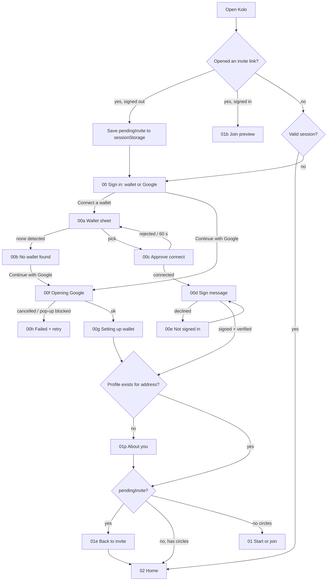

# Kolo: design handoff for Forge
Studio · v2.3 · 3 Nov 2026 (v2.3: real sign-up, wallet or Google, profile, invite return; see §8. v2: simulated naira ramp, refresh-based feed, final brand; v2.1: wallet-first sign-in; v2.2: automatic payout). Every name, amount, date and score here is **demo data** (Balogun Street Ajo, 6 members, ₦20,000 a month, $1 = ₦1,492.50). Swap in live values. Keep the copy.

- Screens (HTML source + 2x PNG): `screens/`. Generator: `screens/src/screens_{a,b,c,d,e}.py` with components in `screens/src/kit.py`. Re-render with `python3 screens/src/build.py && python3 screens/src/render.py`.
- Tokens: `brand/tokens/kolo-tokens.css` (CSS vars) and `brand/tokens/tailwind.config.snippet.ts`. Font notes: `brand/tokens/font.md`.
- Logo: **option A, "Round the pot" (chosen)**. Final production assets in `brand/final/` (see §5). `brand/option_A/B/C/` are kept for history; the screens reference `option_A/kolo_mark.svg`, identical to `final/kolo_mark.svg`.
- Overview for sharing: `overview.png`.

## 1. Direction
1. Kolo looks like a market ledger: cream paper, clay-brown ink, one terracotta action colour. There is no dark mode for the hackathon.
2. Every amount is naira first with USDC beside it in muted text (`₦20,000 · $13.40`), because people think about their ajo in naira.
3. Indigo (`accent`) is used only for **Kolo's own voice**: the lightbulb, "Kolo noticed", the learned timeline and "Saved securely" proofs. Judges learn in one glance that indigo means the memory did something.
4. Gold (`turn`) means **whose turn it is**, and nothing else. The same gold is the highlighted member in the logo, so the logo explains the payout order.
5. Every change Kolo makes is shown as a before → after pair of chips. Before is struck through on sand; after is white on terracotta. Every change has an Undo.
6. The copy has no chain words. A person "pays", the pot "pays out", a record is "saved securely", and Kolo "noticed". The only exception is the **View details** disclosure on receipts (06e2), which holds the network and transaction ID for people who want them.

## 2. Tokens
Hex is the source of truth. The CSS file carries the same values as shadcn HSL channels (`--primary: 17 72% 39%`), and Tailwind colours are `hsl(var(--x) / <alpha-value>)`, so `/50`-style opacity works.

| Token (Tailwind) | Hex | Use |
|---|---|---|
| `background` | #FBF6EE | App background (cream) |
| `card` | #FFFFFF | Cards, sheets |
| `secondary` / `muted` | #F4ECDF | Insets, chips, skeletons, "before" chip |
| `foreground` | #2A1F17 | Ink |
| `muted-foreground` | #6E5F50 | Meta text |
| `border` / `input` | #E6D9C6 | Borders |
| `primary` | #A9441C | Terracotta: the one action per screen, the "after" chip |
| `primary-foreground` | #FFFFFF | |
| `primary-soft` | #F7E3D6 | Selected option tint, type badge |
| `accent` | #2B4A7A | Indigo: Kolo's voice only |
| `accent-soft` | #E4EAF4 | Kolo noticed card |
| `success` / `success-soft` | #2E7048 / #E2F0E6 | Paid, on time, consent on |
| `warning` / `warning-soft` | #9A5B00 / #FBEBCF | Late (not missed), risk flag, ModeBadge |
| `destructive` / `danger-soft` | #B3261E / #FBE3E0 | Missed, failed |
| `turn` | #E2A93B | Whose turn it is. Fill or ring only, never text on cream |

WCAG contrast (computed, `brand/src/palette.py`), all AA for normal text:
ink/bg 14.94 · ink/card 16.07 · muted/bg 5.71 · muted/card 6.15 · muted/secondary 5.24 · white/primary 5.95 · primary/bg 5.53 · primary/primary-soft 4.79 · white/accent 8.89 · accent/accent-soft 7.35 · success/card 5.95 · success/success-soft 5.06 · warning/card 5.43 · warning/warning-soft 4.62 · danger/card 6.54 · danger/danger-soft 5.34 · ink/turn 7.63.
Gold on cream is about 2:1, so gold never carries text. The "Now" tag is ink on gold.

**Type: Plus Jakarta Sans** at 500/600/700/800 via `next/font/google`. It has the ₦ glyph (Inter also has it, DM Sans and Figtree don't). Set `tabular-nums` on every amount.
Scale: `text-display` 32/38 800 · `text-h1` 24/30 800 · `text-h2` 20/26 700 · `text-h3` 17/24 700 · `text-body` 15/22 500 · `text-small` 13/18 500 · `text-micro` 12/16 700 uppercase +0.04em.
Radius: cards 20px, buttons and inputs 12–16px, chips full. Shadow: `shadow-card`, plus `shadow-sheet` for sheets. Main buttons are h-14 (56px) and full width.

## 3. Components → shadcn
| Kolo component | shadcn base | Props / variants |
|---|---|---|
| `AppHeader` | — (flex) | `title, sub?, left: 'back'\|'logo'\|'close', right?` |
| `BottomNav` | — | `active: 'circle'\|'learned'\|'wallet'\|'me'`. 76px with safe-area padding. Tabs: Circle, Learned, Wallet, Me |
| `Button` | Button | `default` (primary), `outline`, `ghost`, `destructive`. Add `size="xl"` (h-14, rounded-2xl, 16px bold). Loading = disabled + `Loader2` spin + "…ing" label |
| `ModeBadge` | Badge | `variant: 'test'\|'sandbox'`. One component: dashed warning border, warning-soft fill, `FlaskConical` icon. **Now:** only `test` = "Test mode · not real money", on every wallet/ramp/withdraw screen (06a–07e). **Later:** `sandbox` = "Sandbox · simulated, no real naira moves", reserved for a future real ramp partner's sandbox; if both ever apply, stack test first, never merge. See `c1-mode-badges.png` |
| `MemberAvatar` | Avatar | `name, size: sm 20/md 36/lg 48/xl 56, ring?: 'turn'\|'you'\|none, dim?` (paid out). Fallback = initial on a fixed tint per member (hash the name into 6 tints, see `kit.py AV`) |
| `Money` | — | `ngn, usd, size`. Renders `₦20,000 · $13.40` with USDC in muted |
| `PotCard` | Card + Progress | `paid, total, potNgn, potUsd, dueAt, recipient, state: 'ok'\|'late'\|'empty', showOrder`. Progress turns `warning` when late. 6 tick segments under the bar are optional |
| `PayoutStrip` | — | `order: {member, month, status: 'scheduled'\|'paid'\|'skipped'}[]` plus `currentRound` and `me`. The data has 3 statuses; the badge shows 5 looks: `paid` = dimmed avatar + ✓month; `scheduled` = gold "Now" (this round), terracotta "Next" (me next) or the month; `skipped` = faded avatar + "Skipped" (`SkipForward`). Grid of 6. For more than 6, scroll horizontally with "See all". See `c2-payout-badges.png` |
| `PayoutDoneCard` | Card | `payout` (shape in §02g). Success border. "Round {n} complete" + time, recipient avatar with gold ring, "Pot paid to {name} · ₦…", USDC muted, how line, ref + receipt link |
| `PayoutReceived` | — (page) | `payout`. Recipient's own full-screen confirmation, `ModeBadge test` top right |
| `ReleasePayoutBar` | Button + Sheet | Manual fallback only (`mode:'manual'`). Sticky "Release payout to {name}" → confirm sheet with steps |
| `FeedItem` | — (li) | `{member, action: 'paid'\|'late'\|'reminder'\|'pending', amountNgn?, amountUsd?, at, note?, isNew}`. Time text is always from the item's own `at` ("14 min ago"), never "just". New since last fetch = success-soft background for 3s. `pending` = dashed border, clock badge |
| `FeedFreshness` | — + Button(icon) | `fetchedAt, refreshing, onRefresh`. Live dot if `now - fetchedAt < 30s`, else "Updated N min ago"; refreshing = "Updating…" + spinning icon, list at 60% opacity |
| `NoticedStrip` / `NoticedCard` | Card | `text, href → /learned`. Indigo. The strip is used on Home |
| `LearnedEntry` | Card | See §5. Sub-parts: `ChangeChips(before, after, beforeCaption?, afterCaption?)` and `SwapChips(before[], after[])` |
| `ProofLink` | — (a) | `href=proof_url, label='Saved securely'`, `ShieldCheck` + `ArrowUpRight`, indigo underline. Opens in a new tab |
| `WalletSheet` | Sheet (bottom) | `wallets: {name, icon?, detected}[], recommended='Slush', state: 'list'\|'none'\|'connecting'` → `onSelect(wallet)`. Slush first and pre-selected, then "Other wallets". `none` = 00b (Get Slush → slush.app/download, try again). `connecting` = 00c. See §00 |
| `UndoSheet` | Sheet (bottom) | `entry, reasons[]` → `onUndo(reason?)` |
| `StepList` | — | `steps: {label, sub?, state: 'done'\|'doing'\|'todo'\|'fail'}[]`. Used by pay, lender check and ramp |
| `PaySheet` | Sheet (bottom) | `state: 'confirm'\|'paying'\|'failed'\|'paid'` |
| `ReliabilityScore` | Card | `label, score(0–100), onTime {n, of}, streak, circlesCompleted, history: ('on'\|'late'\|'miss')[]` |
| `ConsentControls` | Select + Switch | `visibility: 'circles'\|'only_me'`, `lenderChecks: boolean`, `checksThisMonth` |
| `SeeWontSee` | Card | Fixed lists, see 05a copy |
| `CurrencyOption` | RadioGroup item | `value: 'ngn'\|'usdc', title, sub, tag?`. Naira is always first |
| `QuoteBox` | — | `rate, fee (₦0 · test mode), youGet, rateSource='Tatum price data', updatedAt, holdMins=10` |
| `RampStep` | — (full screen) | `direction: 'deposit'\|'withdraw', phase: 'confirming'\|'adding'\|'done'\|'failed'\|'quote_changed', quote`. In-app only, no external partner |

| `Receipt` | Card + Collapsible | `rows[], ref, timestamp, details{network, asset, txId, txUrl, account}` |
| `Toast` | Sonner | Use only for "Copied", "Reminder sent" and "Undone · reminder back to 25th 9:00" |
| Code input / form | Input, Label, Tabs, ToggleGroup, Calendar in Popover | Create/Join switch = `Tabs`. "How often" = `ToggleGroup` |

## 4. Screens
### 00 Sign in: wallet-first (`00-signin`, `00a-wallet-sheet`, `00b-no-wallet`, `00c-wallet-connecting`)
> **Superseded by §8 (v2.3).** Google is now first-class and the screens below were re-rendered. Where this section and §8 disagree, §8 wins. 01 create/join copy below still applies except where §8 changes it.

Sign-in **is** connecting a wallet. There is no Google or email dependency.

- **00-signin**
  - Logo lockup (`brand/final/kolo_lockup_light.svg`).
  - H1 "Save together. Get paid on your turn." Body "Run your ajo, esusu or family contribution in one place. Kolo tracks who has paid, reminds people at the right time and pays out the pot when it's full."
  - Three ticks: "Everyone sees the same record" / "The pot pays out automatically" / "Kolo learns how your circle pays".
  - **Primary `Button` "Connect wallet"** (lucide `Wallet`). Under it: "Use a wallet app you already have, like Slush. Your money stays in your wallet; Kolo can't move it without your OK."
  - Text link "I don't have a wallet yet" opens 00b directly.
  - **Stretch slot:** directly below the primary button, reserve room for one quieter secondary option, e.g. an outline "Continue with Google · Coming soon", disabled. It is not drawn on the static screen. It must never be required to use Kolo, and it never replaces "Connect wallet" as the primary.
- **00a Wallet list (`Sheet`, title "Connect a wallet")**
  - Intro: "Pick the wallet you use. You'll approve in that app; Kolo never sees your recovery phrase."
  - First row **Slush**, pre-selected: "Recommended", with a success tag "On this device" when it is detected.
  - Then the section **"Other wallets"**, listing every other detected wallet by its own name. Phantom and Nightly in the frame are examples.
  - Footer: "Don't see yours? Get Slush".
  - **Copy note:** Forge's brief said "Other Sui wallets". The section is labelled "Other wallets" because "Sui" is banned in member UI; filter the list to compatible wallets in code instead.
  - Rows use a neutral letter tile, not the wallet brand logos. If Forge uses the wallet's own icon from detection, that is fine.
- **00b No wallet found (`Sheet`)**
  - Shown when detection returns nothing, or from the link on 00.
  - Wallet icon; H "You'll need a wallet app"; "Kolo keeps your savings in a wallet only you control. Slush is free and takes about 2 minutes to set up."
  - Primary "Get Slush" (lucide `ExternalLink`) opens **https://slush.app/download** in a new tab.
  - Outline "I've installed it · try again" re-runs detection.
  - Info note: "Opens slush.app/download. Already use another wallet? Open Kolo in the browser where it's installed."
- **00c Connecting (`Sheet`)**
  - Wallet tile with a spinner; H "Approve in {wallet}"; "{wallet} will ask you to connect to Kolo. This only shares your wallet address; it doesn't move any money."
  - Disabled "Waiting for {wallet}…" and ghost "Use a different wallet".
  - If the member rejects, or nothing happens after 60 s, return to 00a with a toast: "Not connected. Try again when you're ready."
- **Dev notes (not in UI)**
  - Use the Sui Wallet Standard (`@mysten/dapp-kit` `ConnectModal` data, or `useWallets()`) to fill 00a.
  - Optionally register the Slush web wallet (`@mysten/slush-wallet`) so Slush appears even with no extension. In that case 00b shows only when the web wallet is unavailable too.
  - After connecting, sign a "Sign in to Kolo" personal message to start the session.
  - No new password; the address is the account.

### 01 Start a circle (`01-create`) / Join (`01b-join`, `01c-join-invalid`)
- Tabs: "Start a circle" | "Join with a code".
- **Create** fields:

  | Field | Control and default |
  |---|---|
  | Circle name | text |
  | Amount per person | ₦ input, helper "≈ $13.40 each round" from today's rate (Tatum price data) |
  | Members | stepper, 2–12, default 6 |
  | How often | Weekly / Monthly / Every 2 wks |
  | First payment due | date |
  | Who gets paid when | radio: "Kolo suggests" (Recommended), "Kolo orders payouts from how people pay, and tells you when it changes anything." / "Set it yourself", "Drag members into order after they join." |

  Sticky footer: "Each payout ₦120,000 · $80.40" and button "Create circle".
  Data: `{name, amountNgn, members, cadence, firstDue, orderMode: 'kolo'|'manual'}`.
- **Join**: code input (`KOLO-XXXX`, or paste a link) with a check when valid. Helper: "{inviter} shared this in your WhatsApp group." if shared via a link, otherwise hide it.
  - Preview card: "Preview · you haven't joined yet", circle name, "Started by {organiser}", "You pay ₦20,000 / $13.40 · monthly", "You receive once ₦120,000 / $80.40", avatars plus "5 of 6 joined".
  - Three rules:
    - "First payment due **Wed 25 Nov**, then the 25th of each month for 6 months"
    - "Kolo suggests the payout order. You'll see your turn before round 1."
    - "The pot is held by Kolo and paid out automatically, not by any one member."
  - Buttons "Join {circle}" and "Not now".
  - Invalid code: red input and "We can't find a circle with that code. Check it with the person who sent it. Codes are 4 letters or numbers after KOLO-."

### 02 Circle home (`02-home`, `02b-home-empty`, `02c-home-late`, `02d-home-live`, `02e-home-pending`, `02f-home-refreshing`, `s1`–`s4`)
- **Order, top to bottom:** header (mark, circle name with chevron switcher, "Round 3 of 6 · 6 members", bell) → PotCard with PayoutStrip → NoticedStrip → Activity → sticky Pay button above the nav.
- **PotCard:** "Pot this round", "Due Wed 25 Nov", display "₦80,000 of ₦120,000", "$53.60 of $80.40", progress, "4 of 6 paid", "Goes to {avatar} Bisi".
- **PayoutStrip:** paid out = dimmed avatar + "✓Sep"; now = gold ring + "NOW" gold tag; you next = terracotta ring + "Next"; upcoming = the month.
- **NoticedStrip:** "**Kolo noticed** Tunde pays on the 27th, so his reminder moved there." The whole strip links to /learned and shows the latest entry's short text (`summary_short`, 70 characters max).
- **Activity:** the feed is **not real-time**. It fetches when the circle opens, when the member taps refresh, and every 10 min in the background.
  - Header right side = `FeedFreshness`. **Freshness rule:** if the last successful fetch is under 30 s old, show the green "Live" dot; otherwise show "Updated N min ago" ("Updated just now" is not allowed; under 1 min after 30 s shows "Updated 1 min ago"). The refresh icon button is always there and triggers a fetch.
  - Frames: `02-home` = stale default ("Updated 3 min ago"), `02d-home-live` = fetched under 30 s ago (Live dot, new item highlighted, "20 sec ago"), `02f-home-refreshing` = "Updating…" with spinning icon, list dimmed to 60% and still readable.
  - Rows read "**Ada** paid · 14 min ago · ₦20,000 / $13.40". Time is always relative to the item's own timestamp. Kolo rows use the mark avatar: "Kolo sent Tunde a reminder · Today, 8:00 · moved to the 27th for him".
  - **Pending contribution (`02e-home-pending`):** after the member pays, until a fetch sees the payment, show a local row at the top: "**You** sent · Waiting to show up · sent 10:51 · ₦20,000 / $13.40" (dashed border, clock badge). The pay button becomes a dashed outline "Sent · waiting to show up" with "Your ₦20,000 left your balance at 10:51. You won't be charged twice." The pot count does not change until the fetch confirms it. When the fetch sees it, the row becomes a normal "You paid" row and the button becomes "You've paid this round".
  - Pending item shape: `{id: localTxRef, member: 'me', action: 'pending', amountNgn, amountUsd, sentAt, txRef}`; match it to a fetched `paid` item by `txRef` and drop the local copy. If not seen after 30 min, show "Still waiting · check receipt" linking to the pay receipt.
- **Round header and payout:** see §02g for what happens when the last share comes in.
- **Pay:** "Pay my ₦20,000" with "$13.40 from your Kolo balance · due Wed 25 Nov". Once paid, it becomes an outline success button: "You've paid this round" / "Next payment due Fri 25 Dec".
- **Empty (02b):** "₦0 of ₦120,000", no strip.
  - Invite card: "1 seat still open", "The circle starts when all 6 have joined. Share this code:", code, copy, "Share on WhatsApp" (WhatsApp green #1F7A4D is the only off-palette colour).
  - Dashed indigo card: "Kolo is listening" / "After round 1, Kolo will show what it noticed about how your circle pays, and anything it changed because of it."
  - Feed empty: "No payments yet" / "Payments show here when the circle updates."
- **Late (02c):** a danger card above the pot: "Tunde is 2 days late" / "₦20,000 · $13.40 still to pay. Bisi's payout waits until the pot is full."
  - Buttons "Nudge Tunde" and "Call". Under them: "Kolo already reminded him today at 8:00. One more nudge is allowed today."
  - Progress bar in warning colour. The due date in red reads "Was due Wed 25 Nov".
- **Pay sheet states:**

  | State | Copy |
  |---|---|
  | Paying (s1) | Steps "Checked your balance" ✓ / "Paying the pot" spinner / "Telling the circle". Disabled button "Paying ₦20,000…". "Keep this open. You won't be charged twice." |
  | Failed (s2) | "Payment didn't go through" / "The network was busy and timed out. **Your ₦20,000 is still in your balance.** Nothing was taken." The step shows "Timed out after 30s · ref {ref}". Buttons "Try again" and "Pay later" |
  | Paid (s4) | "Paid ₦20,000", "$13.40 · round 3 of 6 · {time}", "It shows in the circle at the next update, usually within a few minutes.", ProofLink "Saved securely · receipt", button "Done". Closing it lands on 02e (pending) |

- **Feed first load (s3):** 4 skeleton rows, "Loading…" in the header, then "Getting the latest payments. Payments already made are safe." Use only when there is no cached feed; with a cached feed use the refreshing state.
- Data: `circle {name, round, rounds, members, dueAt, potNgn, potUsd, paidCount}` · `order[] {member, month, status}` · `feed[] {member, action, amountNgn, amountUsd, at, note}` · `feedFetchedAt` · `pending[]` · `latestLearned {summary_short}`.

### 02g–02i Automatic payout (`02g-home-payout-done`, `02h-payout-received`, fallback `02i-release-payout`, `02i2-release-confirming`, badges `c2-payout-badges`)
**Rule:** when the last member of a round pays, the pot goes to that round's recipient **in the same transaction**. There is no payout button. The UI only reports what already happened.

**Data shape** (one per round, from the agent or the chain read):
```ts
type Payout = {
  round: number;            // 3
  recipient: string;        // member id → "Bisi"
  amountNgn: number;        // 120000 (display only, at the round's rate)
  amountUsd: number;        // 80.40 (USDC, the real amount)
  paidAt: string;           // ISO time, shown "Fri 27 Nov, 08:14"
  txRef: string;            // shown "Ref KL-PO-7C21"; opens the receipt
  mode: 'auto' | 'manual';  // 'manual' only if the fallback ships
};
```
The PayoutStrip status per member stays `scheduled` | `paid` | `skipped`. A member flips to `paid` when their `Payout` exists. `skipped` = their turn moved (they left, or asked to wait); tapping shows why.

- **02g Round complete (everyone's home, here Ngozi's)**
  - Header advances to "Round 4 of 6".
  - Top: `PayoutDoneCard`: "✓ ROUND 3 COMPLETE" · "Fri 27 Nov, 08:14" / avatar (gold ring) "Pot paid to Bisi · ₦120,000" / "$80.40 · 6 of 6 paid" (muted) / "Paid automatically the moment Tunde's share came in." / "Ref KL-PO-7C21" + link "View receipt".
  - The card stays on top for 24 h after `paidAt`, then it's just the feed item.
  - PotCard resets for round 4: "₦0 of ₦120,000", "Due Fri 25 Dec", "Goes to You". The PayoutStrip advances: Bisi ✓Nov (paid), **You · NOW** (gold).
  - Feed item at the top (Kolo mark avatar with a success check): "**Round 3 complete** · pot paid to Bisi", "Fri 27 Nov, 08:14 · automatic", "₦120,000 / $80.40". It is highlighted as new on first view.
  - No Pay button in the 24 h after a payout. The next round's Pay button comes back after that.
  - Push or toast to everyone else: "Round 3 complete. Bisi got the pot."
- **02h Payout received (the recipient's own view)**
  - Full screen, once per payout, on next open (or from the push). Close (X) top left, `ModeBadge test` top right.
  - Restrained celebration: the logo's six seats around a terracotta check, with the top seat in gold. One soft scale-in (240 ms). No confetti or sound.
  - "ROUND 3 · BALOGUN STREET AJO" / H1 "Your turn came." / "₦120,000 is in your Kolo balance" / "$80.40 test USDC".
  - Rows: From "All 6 members · round 3" · Arrived "Fri 27 Nov, 08:14" · How "Paid automatically when the last share came in" · Ref "KL-PO-7C21".
  - Buttons: "See my balance" (→ 06a), ghost "Back to the circle".
- **Fallback, only if auto payout can't ship (`mode:'manual'`)**
  - **02i:** when the pot is full and unpaid, the organiser sees a success card, "The pot is full" / "Everyone has paid round 3. One tap sends ₦120,000 · $80.40 to Bisi.", PotCard "6 of 6 paid", "Full · Fri 27 Nov".
    - Sticky button "Release payout to Bisi". Under it: "Only you, as organiser, can release it. Kolo reminds you at 18:00 if it's still waiting."
    - Other members see the card without the button: "Waiting for Ngozi to release it."
  - **02i2 (confirm sheet "Release payout"):** steps "Checked the pot is full" ✓ "6 of 6 shares in" / "Sending the pot to Bisi" spinner / "Telling the circle". Disabled "Releasing…". "Keep this open. The pot can only be paid out once."
  - On success, go to 02g. The how line changes to "You released it after the last share came in." and the feed sub to "· released by you".
  - Failure uses the s2 pattern: "Payout didn't go through. The pot is still full and safe." + "Try again".
- **Errors (auto):** if the last payment lands but the payout part fails, the transaction fails as a whole. Show the pay-failed sheet (s2) to the payer; nothing changes for anyone else.
- **Banned here too:** no "transaction", "contract" or chain words in member copy. Use "paid", "pot", "share", "Ref".

### 03 Savings profile (`03-profile`, full scroll `03-profile-full`)
- Header: avatar, "Ngozi Eze", "2 circles · saving with Kolo since Nov 2025".
- **Score card:** "Savings reliability", "Updated today", label "Very reliable" in success colour, "Pays on time almost every round", number "92/100".
  - Three stats: "11 of 12 / paid on time", "8 in a row / on-time streak", "1 / circle completed".
  - 12 history dots with month initials, and the legend "On time / Late / Missed · Last 12 rounds".
  - Label bands:

    | Score | Label | Colour |
    |---|---|---|
    | 85–100 | Very reliable | success |
    | 70–84 | Reliable | success |
    | 50–69 | Sometimes late | warning |
    | below 50 | Often late | destructive |
    | under 3 payments | Still learning | muted, no number shown |

- **"Who can see your score":** a Select ("Members of my circles" / "Only me").
  - Switch "Let lenders check my score", with helper "They pay $0.01 a check and see your score, on-time rate and circles completed. Never your balance, amounts or who you save with."
  - Footer "Checked 2 times this month · See who checked".
- **"What Kolo knows about you":** rows `{fact, source, id}` with a "That's wrong" action that opens UndoSheet. Demo rows:
  - "Usually pays the day before it's due / From your last 8 payments"
  - "Opens reminders in the evening, not the morning / From 6 reminders · since Jun"
  - "Was late once, in Feb, by 3 days / Balogun Street Ajo, round 4"

### 04 HERO: What Kolo learned (`04-learned`, full scroll `04-learned-full`, undo `04b-learned-undo`)
- Header: back link with the circle name, H1 "What Kolo learned", "14 things noticed · 4 changes made. You can undo any of them." Filter chips: All N / Reminders / Payout order / Risk / Nudges.
- **Entry layout (top to bottom):**
  - indigo dot on a 2px rail;
  - "KOLO NOTICED" with the date and round;
  - **noticed** in 17px bold;
  - source with a file icon;
  - a sand band with "SO KOLO CHANGED" and a type badge (Reminder moved / Order swapped / Risk flagged / Nudge tuned);
  - **chips**: before (19px bold, struck through, sand) → arrow → after (19px extrabold, white on terracotta, optional 12px caption);
  - one-line effect;
  - footer: ProofLink "Saved securely ↗" on the left, outline pill "Undo" on the right.
- **Chip legibility:** keep chips 19px or larger and 44px or taller. They read in the overview at a quarter scale, so they will read in 1080p video. Max 12 characters per chip main line. Longer text goes in the caption.
- The order swap uses `SwapChips`: two stacked position pills before (dimmed) ⇄ "SWAP" ⇄ two after (terracotta).
- **Demo entries (keep these 4 for the video):**

  | Type | Noticed | Before → After |
  |---|---|---|
  | Reminder moved | "Tunde paid late 3 rounds running, always on the 27th" | 25th · 9:00 → 27th · 8:00 |
  | Order swapped | "Tunde's payday is the 27th, 2 days after the pot is due" | 5th Tunde, 6th Femi → 5th Femi, 6th Tunde |
  | Risk flagged | "Emeka has had his payout, and his last 2 payments came 4 days late" | No flag → Watch (reminder 3 days early) |
  | Nudge tuned | "Bisi ignores morning reminders but opened 4 of 4 sent after 6pm" | 8:00 "Payment due" → 19:00 warm, by name |

- **UndoSheet:** title "That's wrong? Undo it", body "Kolo will put Tunde's reminder back to **25th · 9:00** and remember not to move it again.", reversed chips.
  - Reasons (optional): "My payday changed" / "I prefer the 25th" / "Not about me".
  - Buttons "Undo this change" and "Keep it". After undo, show the entry with a muted "Undone by Tunde · {date}" line instead of the chips, and send a toast.
- **Entry data shape:**
```ts
type LearnedEntry = {
  id: string
  noticed: string            // plain sentence, ≤ 80 chars
  summary_short: string      // ≤ 70 chars, for Home NoticedStrip
  source: string             // "From Tunde's payments, rounds 1–3"
  date: string               // ISO; render "28 Oct · round 3"
  round?: number
  change_type: 'reminder_moved' | 'order_swapped' | 'risk_flagged' | 'nudge_tuned'
  before: { main: string; caption?: string } | { order: {pos: number; member: string}[] }
  after:  { main: string; caption?: string } | { order: {pos: number; member: string}[] }
  effect: string             // "Tunde's reminder now lands on his payday."
  proof_url: string          // stored memory record, opened by "Saved securely ↗"
  subject_member?: string
  status: 'active' | 'undone'
  undone_reason?: string
}
```

### 05 Lender score check (`05a`–`05e`)
- **Header:** mark, "Score check", "For lenders · {lender name}", balance pill "Balance $4.20".
- **Subject card:** avatar, name, "Kolo member · asked for a ₦150,000 loan" (the lender supplies the loan context), and a badge "Allows checks" (success) or "Checks off" (muted, lock).
- **05a consent:**
  - "Ngozi has said yes to lenders checking her savings score. She'll get a note that {lender} checked."
  - SeeWontSee: "You'll see: Reliability score · On-time rate · Circles completed". "You won't see: Balance or amounts · Who she saves with · Payment dates".
  - Info: "Each check costs $0.01 from your balance. The result is valid for 24 hours."
  - Button "Check score · $0.01".
- **05b paying:** StepList "Paid $0.01 / From your balance · {time}" ✓ → "Getting Ngozi's score / Checking her consent and record" spinner, a skeleton result card and the disabled button "Checking…".
- **05c result:**
  - "Checked {time} · valid 24 hrs".
  - Success band "Very reliable" with **92/100** at 56px (count-up).
  - "92% / paid on time · 11 of 12" and "1 / circle completed · 1 running".
  - "Score from 12 months of payments across 2 circles. Kolo doesn't share amounts or who she saves with."
  - ProofLink, "Paid $0.01 · ref {ref}", buttons "Done" and "Check someone else".
- **05d denied:** lock, "Emeka hasn't allowed score checks", "Kolo only shares a score when the member says yes. **You weren't charged.**", info "You can ask Emeka. He'll get a request in Kolo and can turn checks on from his profile.", buttons "Ask Emeka to allow checks" and "Back". Check consent **before** charging. Denial costs nothing.
- **05e pay failed:** "The $0.01 payment didn't go through" / "Nothing was taken from your balance and no score was shared. Ref {ref}." Button "Try again · $0.01".
- Developer/API note (never in member UI): the score check is a pay-per-call API, $0.01 USDC on Sui, charged only after consent passes.
- Data: `{subject {name, consent}, priceUsd: 0.01, result {label, score, onTimePct, onTimeN, onTimeOf, circlesCompleted, circlesRunning, months, checkedAt, validUntil, ref, proof_url}}`.

### 06 Wallet and add money (simulated naira ramp)
There is **no ramp partner**. Naira top-up and withdraw are simulated in-app: quote at the Tatum rate → credit (or debit) testnet USDC → mock receipt. Every screen from 06a to 07e carries `ModeBadge variant="test"` under the header. No partner names, no handoff, no "Back to Kolo" return frame.

- **06a Wallet (`06a-wallet`, `06a2-wallet-usdc`):**
  - ModeBadge test, then the "Kolo balance" card. The toggle "₦ Naira | $ USDC" picks the big number (₦111,370 or $74.62), and the other currency shows small beneath it.
  - **Under the toggle, always:** "$1 = ₦1,492.50 · shown for reference" and "Rate source: Tatum price data · updated {hh:mm} {today|date}". If the rate is older than 15 min, show "updated 10:42 · refreshing…" and drop the ≈ value.
  - Buttons "Add money" and "Withdraw". Recent rows mark simulated top-ups: "Today, 10:44 · ₦50,000 · simulated".
  - Data: `{balanceUsd, displayCurrency, rate {ngnPerUsd, source: 'Tatum price data', updatedAt}}`.
- **06b Add money sheet (`06b-deposit-sheet`):** bottom `Sheet`, ModeBadge test.
  - "Pay in with": **Naira** first, selected ("Simulated top-up at today's rate", tag "Most people"), then **USDC** ("Send from another wallet you own").
  - Amount in ₦. QuoteBox: "Rate $1 = ₦1,492.50 · Fee ₦0 · test mode · You'll get $33.50", then "Rate source: Tatum price data · updated 10:42 · held for 10 min".
  - Button "Add ₦50,000". USDC path swaps the amount for a receive address and QR (not designed; same sheet).
- **06c In-app step (`06c-ramp-confirming`):** full-screen route `/wallet/add`, close icon top-left, ModeBadge test.
  - Header circle with spinner, H1 "Confirming your quote…", "Locking today's rate for this top-up."
  - Amount pair card "You add ₦50,000 → Balance gets $33.50".
  - StepList: "Confirming your quote…" ($1 = ₦1,492.50 · Tatum price data · 10:42) → "Adding ₦50,000 to your Kolo balance" → "Receipt ready". Disabled button "Confirming…".
- **06c2 Quote changed (`06c2-quote-changed`, repurposed):** if the 10-min hold lapses before confirm. H1 "The rate moved", "Quotes hold for 10 minutes. Here's today's rate again." Steps: "Your quote expired · Held 10 min · was $1 = ₦1,492.50" (fail) and "New quote · $1 = ₦1,498.20 · Tatum price data · 10:53" (done). Pair "₦50,000 → $33.37". Buttons "Add ₦50,000 at the new rate" / "Cancel".
- **06d results (`06d1`, `06d2`, `06d3`):** the same `RampStep` layout.

  | Phase | H1 / body | Steps | Buttons |
  |---|---|---|---|
  | adding (06d1) | "Adding ₦50,000 to your Kolo balance…" / "You can leave this screen; we'll tell you when it's in." | ✓ quote → spinner "Usually a few seconds" → todo | "Back to wallet" |
  | done (06d2) | "$33.50 added" / "Ready for your next round." | ✓ ✓ ✓ ("$33.50 added · 10:44") | "View receipt", "Back to wallet" |
  | failed (06d3) | "We couldn't add your ₦50,000" / "Nothing changed in your balance. This is a simulated top-up, so no naira left your bank." | ✓ quote → ✕ "Couldn't finish · ref KL-DP-7Q4M2" | "Try again", "Back to wallet" |

- **06e Receipt (`06e-deposit-receipt`, open `06e2-deposit-receipt-details`):**
  - Hero "USDC CREDITED **$33.50**" / "Added to your Kolo balance", then the warning-soft line **"Simulated · no real naira moved"** (FlaskConical icon). This line is mandatory on both receipts.
  - Rows, in order: Naira paid in ₦50,000.00 · Fee ₦0.00 · test mode · Rate $1 = ₦1,492.50 · Rate source "Tatum price data" · Rate updated "27 Oct 2026, 10:42" · Reference "KL-DP-20261027-7Q4M" · Time "27 Oct 2026, 10:44".
  - "View details" (`Collapsible`, closed by default): Network "Sui testnet" · Asset "Test USDC" · Transaction (short ID, link out) · Your account (short). **The only place chain words may appear.**
  - ProofLink "Saved securely" below the card.
  - Data: `{direction, ngnIn, feeNgn: 0, ngnPerUsd, rateSource: 'Tatum price data', rateUpdatedAt, usdcCredited, simulated: true, ref, createdAt, details {network, asset, txId, txUrl, account}}`.

### 07 Withdraw (simulated)
- **07a Withdraw sheet:** same sheet as 06b, ModeBadge test. "Get it as": **Naira to your bank** first ("GTBank ••4821 · simulated in test mode"), then USDC. Amount in $ with "$74.62 available". QuoteBox: Rate $1 = ₦1,492.50 → Fee ₦0 · test mode → "Arrives in your bank ₦29,850", then the Tatum source line. Button "Withdraw $20.00".
- **07b In-app step (`07b-withdraw-confirming`):** the `RampStep` with header "Withdraw", pair "You withdraw $20.00 → Bank gets ₦29,850", steps "Confirming your quote…" → "Sending ₦29,850 to GTBank ••4821" → "Receipt ready".
- **07c results:** same `RampStep`, not drawn separately:

  | Phase | Copy |
  |---|---|
  | sending | "Sending ₦29,850 to your bank…" / "You can leave this screen." |
  | done | "₦29,850 sent" / "Simulated · it shows as sent to GTBank ••4821." |
  | failed | "We couldn't send your money" / "Your $20.00 is still in your Kolo balance. Ref {ref}." + "Try again" |
  | quote_changed | as 06c2, with "Withdraw $20.00 at the new rate" |

- **07e Withdraw receipt:** hero "NAIRA SENT **₦29,850.00**" / "To GTBank ••4821 · Ngozi Eze", then **"Simulated · no real naira moved"**. Rows: USDC withdrawn $20.00 · Rate $1 = ₦1,492.50 · Rate source Tatum price data · Rate updated · Fee ₦0.00 · test mode · Reference KL-WD-… · Time. Same "View details".

### Test and sandbox labels
- `ModeBadge` is the only component for these labels.
- **Now:** `test` on 06a, 06b, 06c, 06c2, 06d*, 06e*, 07a, 07b, 07c, 07e. Directly under the header, never dismissible.
- **Later:** `sandbox` ("Sandbox · simulated, no real naira moves") stays in the component for a future real ramp partner's sandbox. It is not used on any current screen.
- Neither badge appears inside the learned timeline chips or score cards, so the video frames stay uncluttered.

## 5. Brand (final: option A, "Round the pot")
Final files live in `brand/final/` (full list and placement in `brand/final/README.md`). Next.js App Router placement:

| File | Put it at |
|---|---|
| `icon.svg` | `app/icon.svg` |
| `apple-touch-icon.png` | `app/apple-icon.png` |
| `favicon.ico` | `app/favicon.ico` |
| `og-image.png` | `app/opengraph-image.png` |
| `twitter-image.png` | `app/twitter-image.png` |
| `icon-192.png`, `icon-512.png`, `maskable-512.png`, `site.webmanifest` | `public/` |
| `kolo_lockup_light.svg`, `kolo_mark.svg` | `public/brand/` (header, sign-in) |

Use `kolo_mark.svg` in the app header and `kolo_lockup_light.svg` on 00 sign-in. Never spin the mark as a loader.

## 6. Motion (keep it to these)
- Feed item: items new since the last fetch slide down 8px and fade in over 200ms ease-out, with a success-soft background that fades over 3s. The refresh icon spins only while fetching. The pot number counts up over 400ms and the progress bar animates width over 400ms.
- The score number counts up from 0 over 600ms on 05c and 03, with the label fading in at the end.
- Learned entry: when a new one arrives, the after chip scales 0.96 → 1 over 160ms. On Undo, the chips cross-fade over 200ms.
- Sheets: shadcn default. Spinners: `Loader2 animate-spin`. Use `motion-reduce:` to disable all of the above.

## 7. Out of scope / fallbacks
- **Feed:** fetch on open, on refresh tap and every 10 min. If a fetch fails, keep the cached list and the old "Updated N min ago", and show a toast "Couldn't update. Try again." No streaming is planned.
- **Naira ramp:** simulated in-app. A real partner later would add the `sandbox` badge and a handoff step; neither is designed now.
- **Rate:** if the price feed fails, show the last rate with "updated {time}" and hide the ≈ conversions older than 15 min. The receipt always shows the rate locked at confirm, with source "Tatum price data".
- **Learned timeline:** if fewer than 4 real entries exist at recording time, seed the demo circle so the 4 entry types all appear. Undo can be local-only (status flip plus a toast) if writing the correction back isn't ready. The undo sheet copy stays.
- **Not designed, use shadcn defaults:** circle switcher list, notifications list, "See who checked" list, member drag-to-reorder for manual order, USDC receive address/QR, settings. Dark mode, the organiser admin screens and a desktop layout are out.
- **WhatsApp share:** use the `wa.me/?text=` link with "Join our Kolo circle Balogun Street Ajo: {link} (code KOLO-7Q4M)".
- Icons are lucide only: `Lightbulb` (Kolo's voice), `ShieldCheck` (saved securely), `FlaskConical` (mode badge), `Undo2`, `ArrowRight`, `ArrowLeftRight`, `AlarmClock`, `TriangleAlert`, `MessageCircleHeart`.

## 8. Sign-up v2.3: wallet or Google, then profile, then circle
Two equal ways in, then one short profile form, then create or join. This replaces the wallet-only §00 and the "Coming soon" Google slot. Ship with `@mysten/dapp-kit` (wallets + `useSignPersonalMessage`) and Enoki zkLogin (`@mysten/enoki`, `registerEnokiWallets` with Google). Everything else is shadcn. No new colours: every screen uses `kolo-tokens.css` only.

### 8.1 Flow


### 8.2 Screens, copy, states, components
| Screen | What it shows (key copy) | shadcn / lucide |
|---|---|---|
| `00-signin` | H1 "Save together. Get paid on your turn." Two **equal** outline `Button`s, same size: "Connect a wallet" (`Wallet`) and "Continue with Google" (official Google "G" asset). Under them: "No wallet yet? Continue with Google and Kolo sets one up for you. Your money stays yours either way." Legal line with terms + privacy links. | `Button variant=outline` ×2 |
| `00a-wallet-sheet` | Slush first, "Recommended", "On this device" tag; "Other wallets" from `useWallets()` (Enoki's Google wallet filtered out of this list). Footer "Don't see yours? Get Slush or continue with Google". | `Sheet`, `Badge` |
| `00b-no-wallet` | "No wallet app found" / "You can get Slush (free, about 2 minutes), or skip it and continue with Google. Kolo will set up a wallet for you." Primary "Continue with Google", outline "Get Slush" (slush.app/download), ghost "I've installed it · try again". | `Sheet`, `Button` |
| `00c-wallet-connecting` | "Step 1 of 2 · Connect" / "Approve in {wallet}" / "This only shares your wallet address. It doesn't move any money." Rejection or 60 s timeout → back to 00a + toast "Not connected. Try again when you're ready." | `Sheet`, `Loader2` |
| `00d-sign-message` | "Step 2 of 2 · Prove it's you" / "Sign in {wallet} to finish" / box: "**Free.** No fee, no payment, no money moves." + "The message reads **"Sign in to Kolo"** with today's date and a one-time code." | `Sheet`, `useSignPersonalMessage` |
| `00e-sign-rejected` | Danger box "You didn't sign, so you're not signed in" / "That's fine. Nothing was shared and no money moved. Kolo needs the signature once to know the wallet is yours." Buttons: "Sign again", "Use a different wallet", ghost "Continue with Google instead". | `Sheet`, `Alert variant=destructive` |
| `00f-google-redirect` | "Opening Google…" / "Pick your Google account in the window that opens. Kolo only gets your name and email to set up your wallet." Fallback link "Nothing opened? Open Google sign-in" (same-tab redirect). | `Sheet` |
| `00g-google-wallet-setup` | "Setting up your Kolo wallet" / "This takes a few seconds. You won't need a recovery phrase. Your Google account is how you get back in." Steps: Signed in with Google ✓ → Creating your wallet (spinner) → Done. "Keep this page open." | `Sheet`, checklist |
| `00h-google-failed` | "Google sign-in didn't finish" / "The window was closed or Google said no. No wallet was created and nothing was saved." Info: "If no window opened, your browser may have blocked it. Allow pop-ups for Kolo, or tap Try again and we'll open Google in this tab." Buttons "Try again", "Connect a wallet instead". | `Sheet`, `Alert` |
| `01p1…01p4-profile-*` | Title "About you", sub "Step 1 of 1 · takes 20 seconds". Status card ("Signed in with Google · Your Kolo wallet is ready · 0x7a3f…c91e" or "Connected with Slush · …"). Body "Tell your circle who you are. We don't copy anything from Google, so type it how you want it." Fields First name, Last name, Display name, live preview "Circle members will see: [N] Ngozi E.". States: empty (Continue disabled, focus on First name), filled, error (top banner "Fix 2 things to continue."), saving ("Saving…", form dimmed and locked). | `Form`, `Input`, `Label`, `Button` |
| `00i-signed-in-header` | Header right: `WalletChip` = avatar initial + display name + short address (`0x7a3f…c91e`, first 6 + last 4). Google users get a small "G" badge on the avatar. | `Button variant=outline`, `Avatar` |
| `00j-chip-menu` | `DropdownMenu`: header (name, "Signed in with Google" or "Slush wallet", address), "Copy wallet address" (toast "Address copied"), "View on explorer" (Suiscan, new tab), "Edit profile", separator, "Sign out" (destructive). | `DropdownMenu`, `Copy`, `ExternalLink`, `LogOut` |
| `00k-signout-confirm` | "Sign out of Kolo?" / "Your circles and money stay as they are. To get back in, continue with the same Google account." (wallet users: "…connect the same wallet.") Buttons "Sign out" (danger), "Stay signed in". | `AlertDialog` |
| `01-create` | As §01, header sub "Signed in as {displayName}". Old name chip removed (identity lives in the WalletChip). | unchanged |
| `01b-join` | As §01; helper becomes "From {inviter}'s invite link. You'll join as **{displayName}**." | unchanged |
| `01c-join-invalid` | Error "We can't find a circle with that code. Check it with the person who sent it. Codes look like KOLO- and 4 letters or numbers." + card "Opened an old link? Invites stop working when a circle is full or the organiser turns the link off. Ask for a new one." | `Card` |
| `01d-invite-signed-out` | 00 with the feature ticks swapped for an invite card: "{inviter} invited you to {circle}. Sign in and we'll take you straight back to the invite." | `Card` |
| `01e-invite-return` | 01b with success strip "You're signed in. Here's the invite you opened." Join still needs an explicit tap. | `Alert` |

**Profile validation copy** (validate on blur, then on every change once touched; trim spaces):
- First name: required, 1–40 chars, letters, spaces, `'` and `-`. Empty: "Add your first name." Bad chars: "Use letters, spaces, ' or - only."
- Last name: required, 1–40, same rule. Empty: "Add your last name. Only you and Kolo see it."
- Display name: required, 2–24 chars, letters/numbers/spaces/`.'-`. Short or long: "Use 2 to 24 characters." Taken in the same circle (checked at join, not here): "Someone in this circle already uses {name}. Add an initial."
- Save failure: toast "Couldn't save. Check your connection and try again." Form keeps the values.
- Nothing is prefilled from Google (honesty rule). Do not show the Google email in member UI.

### 8.3 Data shapes
```ts
type Profile = { firstName: string; lastName: string; displayName: string;
  address: string;                 // Sui address, wallet or zkLogin-derived
  authMethod: 'wallet' | 'google'; createdAt: string /* ISO */ };
type Session = { address: string; authMethod: 'wallet'|'google'; walletName?: string; // 'Slush'
  expiresAt: string };
type PendingInvite = { code: string /* KOLO-7Q4M */; inviter?: string; circleId?: string;
  returnTo: string /* '/join/KOLO-7Q4M' */; savedAt: string };  // sessionStorage 'kolo.pendingInvite', 30 min TTL
type SignInMessage = `Sign in to Kolo\nAddress: ${string}\nDate: ${string}\nCode: ${string}`; // nonce from server, single use, 5 min
```
Only `displayName` (plus avatar initial) is shown to other members. `lastName` is private.

### 8.4 Edge cases
- **Returning user:** profile found for the address → skip 01p, go to pendingInvite or 02 home. Toast "Welcome back, {displayName}."
- **Wallet already linked:** one address = one profile. If a Google user later connects a wallet with a different address, it's a different account; no merging for the hackathon. If the wallet's address already has a profile, just sign in.
- **Session expiry:** wallet sessions last 7 days; zkLogin follows the Enoki session (re-auth when the ephemeral key expires). On expiry, keep the current URL as `returnTo`, show 00 with toast "You were signed out to keep your account safe. Sign in to carry on." Never expire mid-payment; check before opening a pay sheet.
- **Google pop-up blocked:** if the pop-up returns null or closes in under 1 s, show 00h with the pop-up note; "Try again" uses redirect flow in the same tab.
- **Account switched in the wallet extension:** treat as sign-out + new sign-in (back to 00d for the new address).
- **Invite opened while signed out:** save PendingInvite before showing 01d; after sign-in (and profile if new) route to 01e. If the invite is now invalid, show 01c with the "old link" card.
- **Signature never arrives:** 60 s, then 00e copy.

### 8.5 Accessibility
- Every input has a visible `<Label>`; errors use `aria-invalid` and `aria-describedby` pointing at the message; the top error banner is `role="alert"` and focus moves to the first invalid field.
- Focus order: 00 = wallet button → Google button → terms links. Sheets trap focus, Esc closes, focus returns to the button that opened them. DropdownMenu and AlertDialog use shadcn defaults (arrow keys, Esc).
- Every target is at least 44×44 px (buttons 56 px, inputs 48 px, chip 44 px tall).
- Spinners have `aria-live="polite"` text ("Waiting for Slush", "Creating your wallet").
- The WalletChip's accessible name is "Account: {displayName}, wallet {short address}". The address is read as text, not as an image.
- Contrast: all text pairs are from §2 (≥4.5:1). Disabled buttons still carry readable text.
